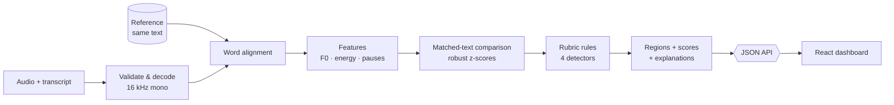

<p align="center">
  
</p>

<h3 align="center">Replace subjective speech judging with reproducible, explainable measurements.</h3>

<p align="center">
  <a href="https://arachne-blush.vercel.app"><b>Live demo</b></a> ·
  <a href="https://youtu.be/MD4yqxJsxXA"><b>Demo video</b></a> ·
  <a href="#-quick-start">Quick start</a> ·
  <a href="#-how-it-works">How it works</a> ·
  <a href="#-dashboard">Dashboard</a> ·
  <a href="#-api">API</a> ·
  <a href="#-rubric">Rubric</a> ·
  <a href="#-results">Results</a> ·
  <a href="#-limitations--honesty-notes">Limitations</a> ·
  <a href="#-team">Team</a>
</p>

<p align="center">
  
  
  
  
  
  
  <a href="https://youtu.be/MD4yqxJsxXA"></a>
  
</p>

---

## 🎬 Demo video

[](https://youtu.be/MD4yqxJsxXA)

Watch the full walkthrough on YouTube: **<https://youtu.be/MD4yqxJsxXA>**. It shows the dashboard running, the contrastive dataset, the rubric, the evaluation and the stress tests.

## Why Arachne?

Judging interpretive, persuasive and extemporaneous speech is subjective: scores vary between judges and feedback is vague.
Arachne treats a performance as a **time-series signal** and compares it with a reference reading of the **exact same text**.
Every finding names the *measured feature*, the *comparison*, the *time span* and the *rubric rule* that produced it.

> **What Arachne claims and doesn't.** A flagged region is a measurable difference from one chosen reference, tied to an explicit rule.
> It is **not** proof of a "wrong" delivery, of the speaker's intent, or of any cause.

| 🎯 **Temporal grounding** | 🧮 **Deterministic** | 🗣️ **Speaker-agnostic** | 🔍 **Traceable** |
| --- | --- | --- | --- |
| Start/end timestamps for every deviation, mapped to words. | Robust z-scores and explicit rules. Same input + config = same output. | Pitch in semitones re speaker median; energy median-centred. | Config hash, rubric version and rule IDs in every result. |

## 🧭 How it works



| Stage | Module | What it does |
| --- | --- | --- |
| 1. Input | `audio_io.py` | Decodes/validates audio; clear error codes for unsupported, short, silent or mismatched input. |
| 2. Alignment | `align.py` | Default `proportional` backend: silence chunking → reference-prior DP word assignment → energy-valley Viterbi boundaries. Optional `whisperx` backend (see limitations). |
| 3. Features | `features.py` | Energy (dB), F0 via Praat autocorrelation, semitones re speaker median, per-word and pause features. |
| 4. Comparison | `compare.py` | Four deterministic detectors on matched words with MAD-based robust z-scores. |
| 5. Scoring | `scoring.py` | Per-dimension and overall score; returns **insufficient evidence** instead of guessing when SNR, voicing or alignment are inadequate. |
| 6. Dashboard | `src/` | React + Vite front end that calls the JSON API and renders playback, overlays and explanation cards. |

## 🖥️ Dashboard

The dashboard is built against the real API schema (no separate mock contract) and is live at **[arachne-blush.vercel.app](https://arachne-blush.vercel.app)**.

- Upload an audio file and transcript, and pick a same-text reference.
- Clear validation and processing states, including `insufficient_evidence` and error messages.
- Audio playback with the transcript, aligned word by word.
- Baseline-vs-performance time-series overlays with flagged regions highlighted.
- Explanation cards showing the rule ID, measured values, delta, z-score and time span.

## 🚀 Quick start

### 1. Engine and API

```bash
# prerequisites: Python 3.12, ffmpeg; espeak-ng only to build the dev dataset
sudo apt-get install -y ffmpeg espeak-ng
pip install -r requirements.txt

make dataset     # builds ./dataset (63 items, ~70 MB, deterministic)
make test        # 9 tests: determinism, localisation, error handling, API
make evaluate    # writes results/evaluation.md
make stress      # writes results/stress.md
make serve       # API on http://127.0.0.1:8000
```

### 2. Dashboard

```bash
# prerequisites: Bun (or Node 20+)
bun install
bun run dev      # Vite dev server; point it at the API above
```

### 3. Command line

```bash
python -m arachne analyze my_speech.wav \
  --transcript-file transcript.txt \
  --reference gettysburg \
  --out result.json
```

The reference id is a folder under `dataset/references/<id>/` containing `reference.wav` and `reference.json`.

## 🔌 API

| Method | Endpoint | Purpose |
| --- | --- | --- |
| `GET` | `/health` | Engine version, schema version, config hash |
| `GET` | `/references` | Selectable references (id, title, transcript, provenance) |
| `GET` | `/rubric` | Rule definitions and standing limitations |
| `POST` | `/analyze` | Multipart: `audio`, `reference_id`, `transcript` → result JSON |

`POST /analyze` returns `200` with `status` = `ok` or `insufficient_evidence`; invalid input returns `422` with machine-readable `messages`.
Full field reference: [`docs/schema.md`](docs/schema.md).

**Example region (format)**

```json
{
  "rule_id": "PAUSE-1",
  "dimension": "pauses",
  "direction": "long",
  "start_s": 20.81,
  "end_s": 22.66,
  "measured": { "part_pause_s": 1.87, "ref_pause_s": 0.06 },
  "delta": 1.81,
  "delta_unit": "s",
  "z": 18.1,
  "severity": 1.0,
  "severity_label": "strong",
  "explanation": "After word 31 ('...'): pause of 1.87s vs 0.06s in the reference (+1.81s longer). Rule PAUSE-1 (z=18.1)."
}
```

Values are illustrative of the format.

## 📏 Rubric

Every rule specifies feature, normalization, window, threshold and feedback template (`arachne/rubric.py`).

| Rule | Dimension | Feature | Fires when |
| --- | --- | --- | --- |
| `PACE-1` | Pacing | Articulation time per 3-word window (pauses excluded), relative to the utterance-wide pace ratio | robust z ≥ 2.5 and ≥ ~22% over ≥ 3 words |
| `PAUSE-1` | Pauses | Silent gap after word | ≥ 0.30 s longer than reference and z ≥ 2.5 |
| `PAUSE-2` | Pauses | Silent gap after word | reference pause ≥ 0.25 s and participant ≤ 40% of it |
| `PITCH-1` | Pitch contour | Local spread of word pitch (semitones, speaker-scaled) vs reference | z ≥ 2.5, ≥ ~1.8× change, over ≥ 4 words |
| `ENERGY-1` | Energy | Word energy (dB) relative to speaker median | z ≥ 2.5 and ≥ 4 dB over ≥ 3 words |

Overall score is a weighted mean of dimension scores (pacing 0.30, pauses 0.20, pitch 0.25, energy 0.25); the formula is returned with every result.

## 📊 Results

> **Read this first:** the current dataset is **synthetic** (espeak-ng speech, flaws injected programmatically). These numbers show pipeline behaviour on controlled single-factor flaws, **not** performance on human speech.

**Held-out speeches** (2 speeches, 42 items; thresholds were not tuned on them). Label tolerance: exact by construction.

| Dimension | Ground-truth spans | Recall @ IoU 0.3 | Recall @ IoU 0.5 | Mean IoU (matched) |
| --- | ---: | ---: | ---: | ---: |
| Pacing | 14 | 0.86 | 0.86 | 0.92 |
| Pauses | 20 | 1.00 | 1.00 | 0.95 |
| Pitch contour | 8 | 0.88 | 0.88 | 0.66 |
| Energy | 6 | 1.00 | 0.83 | 0.89 |

- False-positive regions across the 42 held-out items: **4**; flagged regions on the 4 near-perfect mirrors: **0**.
- Severity ordering (dimension score falls as severity rises): **12 / 12** series.
- Pitch boundaries are loose (mean absolute boundary error ≈ 0.7 s); pacing and energy are tighter.

**Stress test (1 speech, 21 items)**

| Variant | Outcome |
| --- | --- |
| MP3 round-trip (48 kbps → 44.1 kHz) | Unchanged vs clean |
| 3 s added lead/trail silence | Unchanged vs clean |
| Noise 30 dB SNR | Pause recall 0.8, 5 false-positive regions |
| Noise 20 dB SNR | **Degrades**: 42 false-positive regions, pause recall 0.4 |
| Noise 10 dB SNR | **Degrades**: 27 false-positive regions; noise warning raised |

Treat noisy recordings as unsupported until the speech/pause detector and SNR estimate are improved. Details: `results/stress.md`.

## 🗂️ Dataset

Each speech has 21 items: 2 near-perfect mirrors (same / different speaker, with natural-variation jitter), 6 single-factor flaw families × 3 severities
(`pace_fast`, `pace_slow`, `pause_excess`, `pause_missing`, `pitch_flat`, `energy_quiet`), and 1 three-flaw combo.
Texts are short excerpts of public-domain US speeches (Gettysburg Address, Second Inaugural, FDR First Inaugural).
Each manifest row carries transcript, voice, flaw type/severity, ground-truth spans, format and provenance, labelled `exact_by_construction; not human-reviewed`. See [`docs/dataset.md`](docs/dataset.md).

## 🧱 Project structure

```
Arachne/
├── backend/          # Python engine + API: audio_io · align · features · compare · rubric · scoring · pipeline · api
├── src/              # React dashboard (Vite + TypeScript)
├── dataset/          # contrastive dataset: references, mirrors, manifest
├── eval/             # evaluation and stress-test harness
├── docs/             # schema.md · dataset.md
├── Instructions/     # Plan.md · role instructions · design spec
├── server.ts         # dev/server entry for the web app
├── index.html · vite.config.ts · package.json · bun.lock
├── IDEA.md · metadata.json · banner.png
└── README.md
```

## ⚠️ Limitations & honesty notes

- **Synthetic data only so far.** Real public-domain recordings, human re-recordings and human review of labels are still to be added; no label-accuracy claim is made.
- **Alignment is approximate.** The default aligner is a deterministic, model-free fallback. The WhisperX backend is implemented but untested here; re-run the evaluation after enabling it on real audio.
- **Noise sensitivity.** Results degrade at ≤ 20 dB SNR (see stress test).
- **Small, single-factor evaluation.** Thresholds were set a priori and adjusted once on one speech; real delivery is messier than injected flaws.
- **Measurements, not verdicts.** z-scores are robust standardisations within a recording pair, not universally calibrated judgments.

## 🛣️ Roadmap

**Delivered**

- [x] Deterministic pipeline: alignment, features, four rubric detectors, scoring
- [x] Evidence-linked explanations with rule IDs
- [x] Synthetic contrastive dataset + evaluation + stress harness
- [x] REST API and result schema
- [x] React dashboard (audio upload, playback, time-series overlays, explanation cards), deployed on Vercel
- [x] Technical document and README
- [x] [Demo video](https://youtu.be/MD4yqxJsxXA) (YouTube)
- [x] Devpost submission

**Next steps after the hackathon**

- [ ] Real public-domain baselines with verified reuse terms
- [ ] Human re-recordings and human-reviewed alignment/flaw labels
- [ ] WhisperX forced alignment validated on real audio
- [ ] Noise-robust speech/pause detection and SNR estimate

## 🤖 AI assistance disclosure

Parts of this repository (pipeline code, dashboard, tests and documentation) were written with assistance from AI tools: **Claude (Anthropic)**, **ChatGPT (OpenAI)**, **Gemini (Google)** and **Cursor**.
All AI-assisted output was reviewed by the team. The same tools are listed under *Built With* on the Devpost page.

## 👥 Team

**Team Kelambakkam Atti** · Multimodal AI Hackathon 2026, Track C

<table>
  <tr>
    <td align="center" width="25%">
      <a href="https://github.com/mdammar56"><b>Ammar</b></a><br>
      <sub>@mdammar56</sub><br><br>
      <b>Dataset Lead</b><br>
      <sub>Source speeches, contrastive dataset (references and flawed mirrors), provenance, annotation and labels.</sub>
    </td>
    <td align="center" width="25%">
      <a href="https://github.com/Abdude69"><b>Abdul</b></a><br>
      <sub>@Abdude69</sub><br><br>
      <b>Signal Processing Lead</b><br>
      <sub>Audio validation, alignment, F0 / energy / pause feature extraction, speaker-agnostic normalization.</sub>
    </td>
    <td align="center" width="25%">
      <a href="https://github.com/HABIBEEYY"><b>Rihan</b></a><br>
      <sub>@HABIBEEYY</sub><br><br>
      <b>Grounding &amp; Scoring Lead</b><br>
      <sub>Robust z-score model, rubric rules, temporal flaw grounding, explanations, IoU and boundary-error evaluation.</sub>
    </td>
    <td align="center" width="25%">
      <a href="https://github.com/mohamedfadil12"><b>Mohamed Fadil</b></a><br>
      <sub>@mohamedfadil12</sub><br><br>
      <b>Dashboard &amp; Delivery Lead</b><br>
      <sub>React dashboard, API integration, README and technical document, demo video, Devpost submission.</sub>
    </td>
  </tr>
</table>

| Member | GitHub | Role | Primary ownership |
| --- | --- | --- | --- |
| Ammar | [@mdammar56](https://github.com/mdammar56) | Dataset Lead | `dataset/`, `docs/dataset.md`, annotation guide |
| Abdul | [@Abdude69](https://github.com/Abdude69) | Signal Processing Lead | `audio_io`, `align`, `features` |
| Rihan | [@HABIBEEYY](https://github.com/HABIBEEYY) | Grounding & Scoring Lead | `compare`, `rubric`, `scoring`, `eval/` |
| Mohamed Fadil | [@mohamedfadil12](https://github.com/mohamedfadil12) | Dashboard & Delivery Lead | `src/`, README, docs, Devpost |

---

<p align="center"><sub>Built for the Multimodal AI Hackathon 2026 · Track C: Contrastive Speech Analytics and Temporal Flaw Grounding</sub></p>
